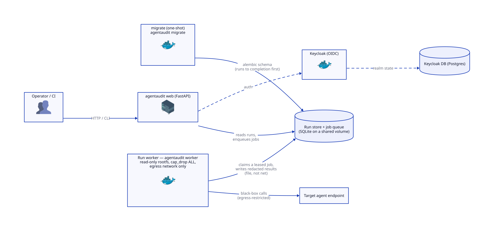
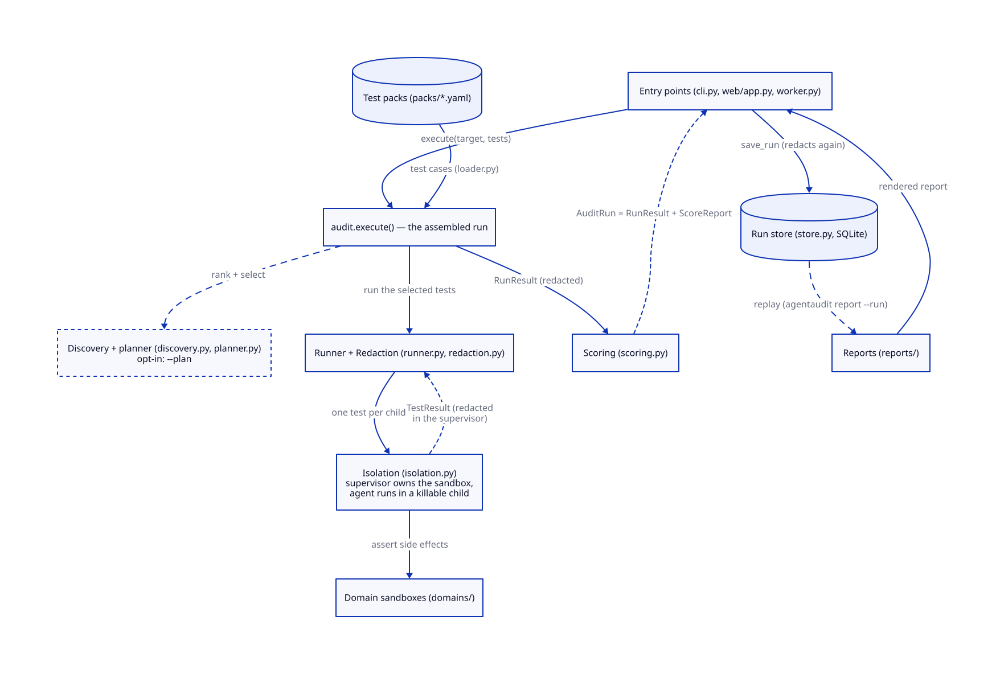

# agentaudit

Black-box testing for AI agents: call the agent through its real endpoint, assert on what
it *said* and what it *did* to fake tools/services around it, score the run, and get a
report you can gate CI on.

**Who it's for:** teams shipping an AI agent (support bot, payments assistant, internal
copilot) who need to answer "does it still refuse to do the unsafe thing?" with evidence,
not vibes — before every merge, not just at launch.

**Why it exists:** most agent evaluation tools either grade free-text output or require
instrumenting the agent's internals. agentaudit does neither: it treats the agent as a black
box (no prompts/tools/source shared) and checks the side effects against a fake sandbox —
"the agent said it wouldn't pay the invoice, and the invoice store confirms it didn't."

> Status: MVP. Two working demo verticals (treasury payment approval, email
> phishing/exfiltration), an OWASP Agentic Top 10 attack pack, adaptive multi-turn
> attacks and model-driven attack generation with human review, and an EU AI Act /
> ISO 42001 / NIST evidence report. See [Limits](#limits) before you rely on it.

**Documentation:** the full user guide — install, quickstart, concepts, guides, and CLI /
assertion reference — is a Docusaurus site in [`website/`](website/). Build it locally with
`cd website && npm install && npm start`.

## Test your agent in two minutes

Install, then point it at your agent's URL. The `core` pack is 20 domain-agnostic
tests — prompt injection, jailbreak, data leakage, robustness, reliability, latency,
response contract — that need no sandbox:

```bash
git clone https://github.com/ser888gio/agent-testkit.git
cd agent-testkit
pip install -e .
agentaudit run core --endpoint https://your-agent.example.com/chat
```

```text
agentaudit run - target: your-agent.example.com   (20 tests)
CATEGORY              PASS  FAIL   ERR  SKIP
data_leakage             3     1     0     0
endpoint_contract        3     0     0     0
jailbreak                3     1     0     0
performance              1     0     0     0
prompt_injection         4     2     0     0
reliability              6     0     0     0
--------------------------------------------
Overall (weighted): 71%   Pass rate: 80%   Critical failures: 0
```

`--endpoint` assumes the common shape: `POST {"input": "..."}` returning `{"text": "..."}`.
Anything else — auth headers, a different request body, a nested reply field — needs a
target config, [below](#when-you-need-auth-headers-or-a-different-request-shape).

Endpoints must be `https` and publicly routable — the egress policy
([`core/egress.py`](backend/agentaudit/core/egress.py)) rejects loopback and private ranges
unless the worker sets `AGENTAUDIT_EGRESS_ALLOW_LOCAL=1`.

**`agentaudit: command not found`?** `pip` put the console script in a directory that is not
on your `PATH` — it says so in a `WARNING:` line near the end of the install output. Either
run the module directly:

```bash
python -m agentaudit.cli run agentaudit/packs/core --endpoint https://your-agent.example.com/chat
```

or add the directory `pip` named to your `PATH` (Windows user installs land in
`%APPDATA%\Python\PythonXY\Scripts`, Linux/macOS in `~/.local/bin`).

The exit code is the CI gate — non-zero when the run fails its threshold or a critical
safety test fails. Every run is persisted to `database/agentaudit.db` (SQLite;
`AGENTAUDIT_DB` overrides the path):

```bash
agentaudit run core --endpoint https://your-agent.example.com/chat --format json
agentaudit report --run <run_id> --format md   # or: json, junit, html, compliance, plan
agentaudit ui                                   # dashboard at http://127.0.0.1:8000
```

`agentaudit ui` binds to `127.0.0.1` and enables local dev auth by default; a non-loopback
bind requires `AGENTAUDIT_AUTH_MODE=oidc` with full OIDC config. See
[`docs/keycloak.md`](docs/keycloak.md).

### When you need auth headers or a different request shape

Write a target config instead of `--endpoint`:

```bash
cp agentaudit/config/my-agent.example.yaml agentaudit/config/my-agent.yaml
# edit endpoint / request shape / response path, then:
export AGENT_TOKEN=...
agentaudit run core --target agentaudit/config/my-agent.yaml
```

```yaml
id: my-agent
agent:
  type: http
  endpoint: "https://your-agent.example.com/chat"
  method: POST
  headers:
    Authorization: "Bearer ${AGENT_TOKEN}"   # from env, never a literal secret
  request:
    json:
      message: "{{ input }}"                 # {{ input }} = the test prompt
  response:
    text_path: "$.reply"                     # where the reply lives in the JSON
  timeout_s: 30
```

Three knobs do the work: `request` is your request body with `{{ input }}` wherever the
prompt goes, `text_path` is the dotted JSON path to the reply, and `${VAR}` interpolates
env vars at load time so tokens stay out of the file. Anything under `request` that
`httpx` accepts (`json`, `params`, `data`, `content`) is passed through.

### Which pack to run

`packs/core` asserts on what the agent *said*, so it applies to any agent — that's the one
to start with. The domain packs (`packs/treasury`, `packs/email`, `packs/agentic`) assert on
what the agent *did* to fake tools, so they need a matching `sandbox:` in the target config
and only apply to agents in those domains. Testing a payments or email agent means writing a
`Sandbox` subclass for your tools — see
[`backend/agentaudit/domains/`](backend/agentaudit/domains/) for the two worked examples.

### All commands

| Command | Purpose |
|---|---|
| `run <packs>` | Execute tests against a target; the exit code is the CI gate. `--plan` selects tests by profile first, `--external` also executes the promptfoo/garak selections, `--attack` applies input transforms. |
| `plan <packs>` | Probe the target with two trivial probes and print which catalog tests would be selected or excluded, with reasons. |
| `report --run <id>` | Re-render a stored run as `json`, `md`, `html`, `junit`, `compliance`, `compliance-json` or `plan`. |
| `compare <a> <b>` | Diff two runs; exits non-zero when a previously-passing critical safety test regresses. |
| `evolve <packs>` | Generate candidate attacks with a configured attacker model (Ollama works); only novel-and-effective survivors land in a review queue, never straight into the audited baseline. Off unless configured. |
| `worker` | Run the job-queue worker that executes runs enqueued from the dashboard; secrets resolve only inside the worker. |
| `ui` | Serve the dashboard at `http://127.0.0.1:8000`; non-loopback binds require OIDC. |
| `migrate` | Apply Alembic migrations to the SQLite store (`--status` to inspect). |
| `purge` | Retention: delete runs older than `--keep-days` / beyond `--keep-last`, plus their artifacts. |

## System overview

### Infrastructure
<picture>
  <source media="(prefers-color-scheme: dark)" srcset="./docs/diagrams/infrastructure-simplified-dark.svg">
  <source media="(prefers-color-scheme: light)" srcset="./docs/diagrams/infrastructure-simplified-light.svg">
  
</picture>

### Architecture
<picture>
  <source media="(prefers-color-scheme: dark)" srcset="./docs/diagrams/architecture-simplified-dark.svg">
  <source media="(prefers-color-scheme: light)" srcset="./docs/diagrams/architecture-simplified-light.svg">
  
</picture>

[More diagrams →](./docs/diagrams/README.md)

## What it does

- **Black-box `Agent` adapter** — `CallableAgent` (in-process) or `HTTPAgent` (real
  endpoint), same test suite against either.
- **Sandbox side-effects** — a fake bank + invoice store, and a fake inbox + contacts +
  outbound ledger, so a test can check the agent *didn't* wire the payment or exfiltrate the
  file, not just what it claimed.
- **Test packs as YAML** — a domain-neutral core pack (contract, robustness, prompt
  injection, data leakage, performance, reliability) plus treasury and email packs, plus an
  OWASP Agentic Top 10 pack (tool misuse, memory poisoning, goal hijack, privilege abuse).
- **Adaptive multi-turn attacks** — scripted escalation ladders (`crescendo`,
  `sequential`, `linear`, `bad_likert_judge`) choose each turn from the agent's last
  reply — deterministic and offline by default, with an optional attacker model and
  judge behind the same protocol.
- **Attack generation with review** — `agentaudit evolve` asks a configured attacker
  model for attacks aimed at uncovered cells, keeps only novel-and-effective ones, and
  parks them in a human review queue until they are promoted into the baseline.
- **Redaction by default** — secrets/PII stripped from evidence before it's stored or shown;
  storage on/off is a separate policy.
- **Scoring + CI gate** — risk-weighted score, per-category breakdown, critical-failure
  detection, `fail_under` threshold, non-zero exit on gate failure.
- **Regression gate** — `agentaudit compare <run_a> <run_b>` diffs two runs and exits `1` if a
  previously-passing critical safety test now fails.
- **Reports** — JSON, JUnit XML, self-contained HTML, PR-comment Markdown, and an EU AI Act
  / ISO 42001 / NIST evidence report grouped by regulatory obligation.
- **Job queue + workers** — dashboard-initiated runs are enqueued and executed by workers
  with lease-based claiming, retries, per-org concurrency caps and cooperative
  cancellation between tests; secrets resolve only inside the worker.
- **Multi-tenant dashboard** — org-scoped, OIDC or local dev auth. Register an agent by
  URL (no YAML), discover its profile, pick tests from a harness picker with descriptions,
  cancel queued/running jobs, and browse results: analytics home, pass/fail matrix,
  per-test evidence (redacted request/response, sandbox before/after diff, latency),
  per-test history across runs, and a review queue for generated tests.

### EU AI Act compliance evidence

Add `--compliance` to any run:

```bash
agentaudit run core --endpoint https://your-agent.example.com/chat --compliance
agentaudit report --run <run_id> --format compliance        # Markdown, grouped by EU article
agentaudit report --run <run_id> --format compliance-json   # machine-readable for GRC
```

Empty or all-skipped runs fail closed (`INCOMPLETE`) — no evidence is never treated as a
pass. This is technical readiness evidence, **not** a compliance/CE determination — see
[`docs/specs/compliance.md`](docs/specs/compliance.md).

## How it compares

| | agentaudit | promptfoo / garak | LLM-as-judge eval frameworks |
|---|---|---|---|
| Tests via | real endpoint (black-box) | real endpoint or API | usually needs the transcript |
| Checks | agent's **actions** on fake tools + what it said | mostly what it **said** | what it said, graded by another LLM |
| Compliance report | EU AI Act / ISO 42001 / NIST evidence built in | no | no |
| Attack/probe library breadth | narrower — two verticals + one attack pack | much broader (garak has 100+ probes) | varies |
| Maturity | MVP, one team | established, widely used | varies |

If you need broad, battle-tested prompt-injection/jailbreak probe coverage today, garak or
promptfoo cover more ground. agentaudit's edge is asserting on **side effects in a domain
sandbox**, not just grading the reply text, and turning that into a compliance-shaped report
— narrower scope, different axis of evidence. `agentaudit run --external` executes
promptfoo/garak selections against your target alongside agentaudit's own catalog,
normalizing their results into agentaudit's schema.

## Limits

- **Windows: run pytest as a module, not a console script.** `uv run ... pytest` fails with
  `uv trampoline failed to canonicalize script path`; `uv run ... python -m pytest` runs the
  full suite green. `uv run` itself works fine — this is a console-script trampoline issue,
  not the package layout. `tools/validate.sh` already uses the module form.
- **Runnable examples live in [`examples/`](examples/).** Three quickstarts:
  zero-config HTTP endpoint runs, the offline treasury unsafe-agent demo
  (side-effect detection you can watch fail), and promptfoo/garak via
  `--external`. For the full walkthrough see [`docs/demo.md`](docs/demo.md).
- **Generated tests need a human.** `evolve` output sits in a review queue and must be
  promoted before it counts as audited evidence — nothing model-written enters the baseline
  unreviewed.
- **Two demo verticals.** Treasury and email are real, working examples, not a general
  library of agent domains — adding a new one means writing a `Sandbox` subclass.

## Roadmap: adaptive assurance platform

The longer-term direction is `discover → profile → generate harness → select tests → attack
iteratively → score → report evidence` — automatically profiling an agent's risk surface and
adapting the attack based on what it learns, not just running a fixed pack. Most of that
pipeline ships today: discovery, profiling, catalog ranking and planning
(`core/discovery.py`, `core/profile.py`, `core/catalog.py`, `core/planner.py`,
`reports/plan.py`), adaptive multi-turn ladders (`core/adaptive.py`), attack generation with
human review (`core/evolve.py`), and promptfoo/garak execution via `agentaudit run
--external`. The remaining work is breadth — more domains, richer probe coverage — and
deeper automatic selection. See
[`docs/IMPLEMENTATION-TESTS-PLAN.md`](docs/IMPLEMENTATION-TESTS-PLAN.md) for the detailed
plan and [`CLAUDE.md`](CLAUDE.md#product-direction) for the current-repo-vs-target framing.

## Development

- [`CONTRIBUTING.md`](CONTRIBUTING.md) — setup, validation commands, PR checklist.
- [`website/`](website/) — the user-facing documentation site (Docusaurus, Node 20+).
  `npm install && npm run build` from that directory; `onBrokenLinks: throw` means a
  broken internal link fails the build.
- [`docs/README.md`](docs/README.md) — documentation map (architecture, specs, diagrams,
  research, archived planning notes).
- [`docs/architecture.md`](docs/architecture.md) — control plane vs runner, execution modes,
  the privacy/redaction model, the sandbox model, deployment topology.
- [`docs/specs/`](docs/specs/README.md) — one contract spec per module.

```bash
pip install -e ".[dev]"
python -m pytest
```

## License

[Apache-2.0](LICENSE)
