# Module dependency graph

Generated from AST import analysis of every `agentaudit.*` module. `schema`, `redaction`,
`sandbox`, `findings` and `jsonx` are leaf contracts — everything above depends on them, and
they depend on nothing inside the package (except `redaction -> credentials`).

```mermaid
graph LR
  subgraph entry["entrypoints"]
    cli[cli]
    worker[worker]
  end

  subgraph web["web (frontend/)"]
    app[web.app]
    api[web.api]
    auth[web.auth]
    runtime[web.runtime]
  end

  subgraph reports["reports"]
    rpt[reports/__init__]
    r_json[json]
    r_junit[junit]
    r_md[md]
    r_html[html]
    r_pdf[pdf]
    r_comp[compliance]
    r_cov[coverage]
    r_plan[plan]
    r_charts[charts]
  end

  subgraph core["core"]
    subgraph contracts["contracts / leaves"]
      schema[schema]
      redaction[redaction]
      credentials[credentials]
      sandbox[sandbox]
      findings[findings]
      jsonx[jsonx]
      artifacts[artifacts]
      egress[egress]
      attacks[attacks]
      adaptive[adaptive]
      profile[profile]
      compliance[compliance]
      timeline[timeline]
    end
    config[config]
    agent[agent]
    llm[llm]
    assertions[assertions]
    loader[loader]
    isolation[isolation]
    attacker[attacker]
    judge[judge]
    runner[runner]
    audit[audit]
    scoring[scoring]
    store[store]
    catalog[catalog]
    planner[planner]
    adapters[adapters]
    discovery[discovery]
    evolve[evolve]
    archive[archive]
    campaign[campaign]
    regressions[regressions]
    incidents[incidents]
    incident_promotion[incident_promotion]
    intake[intake]
    runview[runview]
  end

  subgraph domains["domains"]
    d_decl[declarative.sandbox]
    d_toolkit[declarative.toolkit]
    d_email[email.sandbox]
    d_mcp[mcp.sandbox]
    d_treas[treasury.sandbox]
    d_agents[demo agents]
  end

  cli --> audit & runner & loader & store & config & schema & redaction
  cli --> planner & profile & discovery & adapters & attacks & campaign & evolve
  cli --> egress & incidents & incident_promotion & regressions & lifecycle
  cli --> rpt
  cli --> app
  cli --> worker

  worker --> audit & campaign & evolve & runner & store & scoring & loader
  worker --> config & discovery & egress & llm & profile & redaction & schema & lifecycle

  app --> api & auth & runtime & intake
  api --> store & runview & regressions & evolve & intake & loader & llm
  api --> assertions & attacks & config & profile & schema & lifecycle
  api --> auth & runtime
  api --> r_charts & r_html & r_json & r_junit & r_md & r_pdf
  auth --> store
  runtime --> store & intake & loader & schema

  rpt --> r_json & r_junit & r_md & r_html & r_pdf & r_comp & r_cov & r_plan
  rpt --> schema & scoring & profile
  r_json --> schema & scoring & timeline
  r_junit --> schema & scoring & timeline & findings
  r_md --> schema & scoring & timeline & findings & attacks
  r_html --> schema & scoring & timeline & findings
  r_pdf --> schema & scoring & findings & attacks
  r_comp --> compliance & schema & scoring & findings & attacks
  r_cov --> archive & lifecycle & schema & scoring & attacks
  r_plan --> profile

  audit --> runner & scoring & planner & adapters & discovery & profile
  audit --> config & egress & redaction & schema & attacks
  runner --> agent & sandbox & assertions & loader & isolation & judge & attacker
  runner --> adaptive & config & egress & redaction & schema
  isolation --> agent & sandbox & runner & schema
  judge --> agent & attacker & llm & jsonx & redaction
  attacker --> agent & adaptive & llm & jsonx & redaction & schema
  llm --> agent & credentials
  agent --> config & egress
  config --> sandbox & redaction
  assertions --> agent & sandbox & credentials & schema
  loader --> assertions & adaptive & schema
  adapters --> profile & redaction & schema
  planner --> catalog & adapters & profile
  catalog --> assertions & profile & schema
  discovery --> runner & config & profile & schema
  evolve --> loader & assertions & archive & adaptive & attacks & compliance & llm & jsonx & profile & schema & lifecycle
  campaign --> evolve & archive & adaptive & profile & schema
  archive --> adaptive & attacks & schema
  scoring --> findings & schema
  regressions --> scoring & findings & schema
  store --> scoring & loader & profile & config & credentials & egress & artifacts & attacks & redaction & schema
  incidents --> redaction
  incident_promotion --> incidents & evolve & loader & schema & lifecycle
  intake --> loader & config & attacks & schema
  runview --> findings & timeline & attacks & schema
  redaction --> credentials
  profile --> schema
  adaptive --> agent & schema
  timeline --> findings & schema
  compliance --> schema
  attacks --> schema
  findings --> schema

  d_decl --> sandbox
  d_decl --> d_toolkit
  d_email --> sandbox
  d_mcp --> sandbox
  d_treas --> sandbox
  d_agents --> d_decl & d_email & d_treas

  classDef leaf fill:#eef,stroke:#88a
  class schema,redaction,credentials,sandbox,findings,jsonx,lifecycle leaf
```

## Invariants the graph confirms

- `core` has no edge into `domains`, `reports`, `web`, or `cli`.
- `reports` depends on `core` only; `domains` depends on `core.sandbox` only.
- `store` is the sole persistence module; nothing else reaches the DB.
- `cli -> web.app` is the one entrypoint-to-entrypoint edge (the `agentaudit ui` command).
- `reports` no longer reaches `evolve`: test-id and expiry rules live in `core/lifecycle.py`,
  so rendering a coverage report does not import an attacker-model client.

## Change log

<!-- appended by tools/hooks/post-commit -->
- 2026-09-06 — chore: log every commit to docs/GIT_HISTORY.md and the dependency graph
  - touched: tools/hooks/post-commit,tools/validate.sh
- 2026-09-06 — fix: re-ask before profiling an agent as stateless
  - touched: backend/agentaudit/core/discovery.py,tests/test_discovery.py
- 2026-09-06 — test: widen the heartbeat join budget for the extra discovery probe
  - touched: tests/test_worker.py
