# Module dependency graph

Generated from AST import analysis of every `agentaudit.*` module. `schema`, `redaction`,
`sandbox`, `findings` and `jsonx` are leaf contracts — everything above depends on them, and
they depend on nothing inside the package (except `redaction -> credentials`).

```mermaid
graph LR
  subgraph entry["entrypoints"]
    cli[cli]
    worker[worker]
  end

  subgraph web["web (frontend/)"]
    app[web.app]
    api[web.api]
    auth[web.auth]
    runtime[web.runtime]
  end

  subgraph reports["reports"]
    rpt[reports/__init__]
    r_json[json]
    r_junit[junit]
    r_md[md]
    r_html[html]
    r_pdf[pdf]
    r_comp[compliance]
    r_cov[coverage]
    r_plan[plan]
    r_charts[charts]
  end

  subgraph core["core"]
    subgraph contracts["contracts / leaves"]
      schema[schema]
      redaction[redaction]
      credentials[credentials]
      sandbox[sandbox]
      findings[findings]
      jsonx[jsonx]
      artifacts[artifacts]
      egress[egress]
      attacks[attacks]
      adaptive[adaptive]
      profile[profile]
      compliance[compliance]
      timeline[timeline]
    end
    config[config]
    agent[agent]
    llm[llm]
    assertions[assertions]
    loader[loader]
    isolation[isolation]
    attacker[attacker]
    judge[judge]
    runner[runner]
    audit[audit]
    scoring[scoring]
    store[store]
    catalog[catalog]
    planner[planner]
    adapters[adapters]
    discovery[discovery]
    evolve[evolve]
    archive[archive]
    campaign[campaign]
    regressions[regressions]
    incidents[incidents]
    incident_promotion[incident_promotion]
    intake[intake]
    runview[runview]
  end

  subgraph domains["domains"]
    d_decl[declarative.sandbox]
    d_toolkit[declarative.toolkit]
    d_email[email.sandbox]
    d_mcp[mcp.sandbox]
    d_treas[treasury.sandbox]
    d_agents[demo agents]
  end

  cli --> audit & runner & loader & store & config & schema & redaction
  cli --> planner & profile & discovery & adapters & attacks & campaign & evolve
  cli --> egress & incidents & incident_promotion & regressions & lifecycle
  cli --> rpt
  cli --> app
  cli --> worker

  worker --> audit & campaign & evolve & runner & store & scoring & loader
  worker --> config & discovery & egress & llm & profile & redaction & schema & lifecycle

  app --> api & auth & runtime & intake
  api --> store & runview & regressions & evolve & intake & loader & llm
  api --> assertions & attacks & config & profile & schema & lifecycle
  api --> auth & runtime
  api --> r_charts & r_html & r_json & r_junit & r_md & r_pdf
  auth --> store
  runtime --> store & intake & loader & schema

  rpt --> r_json & r_junit & r_md & r_html & r_pdf & r_comp & r_cov & r_plan
  rpt --> schema & scoring & profile
  r_json --> schema & scoring & timeline
  r_junit --> schema & scoring & timeline & findings
  r_md --> schema & scoring & timeline & findings & attacks
  r_html --> schema & scoring & timeline & findings
  r_pdf --> schema & scoring & findings & attacks
  r_comp --> compliance & schema & scoring & findings & attacks
  r_cov --> archive & lifecycle & schema & scoring & attacks
  r_plan --> profile

  audit --> runner & scoring & planner & adapters & discovery & profile
  audit --> config & egress & redaction & schema & attacks
  runner --> agent & sandbox & assertions & loader & isolation & judge & attacker
  runner --> adaptive & config & egress & redaction & schema
  isolation --> agent & sandbox & runner & schema
  judge --> agent & attacker & llm & jsonx & redaction
  attacker --> agent & adaptive & llm & jsonx & redaction & schema
  llm --> agent & credentials
  agent --> config & egress
  config --> sandbox & redaction
  assertions --> agent & sandbox & credentials & schema
  loader --> assertions & adaptive & schema
  adapters --> profile & redaction & schema
  planner --> catalog & adapters & profile
  catalog --> assertions & profile & schema
  discovery --> runner & config & profile & schema
  evolve --> loader & assertions & archive & adaptive & attacks & compliance & llm & jsonx & profile & schema & lifecycle
  campaign --> evolve & archive & adaptive & profile & schema
  archive --> adaptive & attacks & schema
  scoring --> findings & schema
  regressions --> scoring & findings & schema
  store --> scoring & loader & profile & config & credentials & egress & artifacts & attacks & redaction & schema
  incidents --> redaction
  incident_promotion --> incidents & evolve & loader & schema & lifecycle
  intake --> loader & config & attacks & schema
  runview --> findings & timeline & attacks & schema
  redaction --> credentials
  profile --> schema
  adaptive --> agent & schema
  timeline --> findings & schema
  compliance --> schema
  attacks --> schema
  findings --> schema

  d_decl --> sandbox
  d_decl --> d_toolkit
  d_email --> sandbox
  d_mcp --> sandbox
  d_treas --> sandbox
  d_agents --> d_decl & d_email & d_treas

  classDef leaf fill:#eef,stroke:#88a
  class schema,redaction,credentials,sandbox,findings,jsonx,lifecycle leaf
```

## Invariants the graph confirms

- `core` has no edge into `domains`, `reports`, `web`, or `cli`.
- `reports` depends on `core` only; `domains` depends on `core.sandbox` only.
- `store` is the sole persistence module; nothing else reaches the DB.
- `cli -> web.app` is the one entrypoint-to-entrypoint edge (the `agentaudit ui` command).
- `reports` no longer reaches `evolve`: test-id and expiry rules live in `core/lifecycle.py`,
  so rendering a coverage report does not import an attacker-model client.

## Change log

<!-- appended by tools/hooks/post-commit -->
- 2026-09-06 — chore: log every commit to docs/GIT_HISTORY.md and the dependency graph
  - touched: tools/hooks/post-commit,tools/validate.sh
- 2026-09-06 — feat: do not expand attack transforms over skip-tagged tests
  - touched: backend/agentaudit/core/attacks.py,tests/test_attacks.py
- 2026-09-06 — fix: re-ask before profiling an agent as stateless
  - touched: backend/agentaudit/core/discovery.py,tests/test_discovery.py
- 2026-09-06 — test: widen the heartbeat join budget for the extra discovery probe
  - touched: tests/test_worker.py
- 2026-09-06 — @ fix: stop ranking skip-tagged tests in the planner
  - touched: backend/agentaudit/core/catalog.py,tests/test_catalog.py
- 2026-09-06 — fix: stop ranking skip-tagged tests in the planner
  - touched: backend/agentaudit/core/catalog.py,tests/test_catalog.py
- 2026-09-06 — fix: an agent that took no action does not fail a content assertion
  - touched: backend/agentaudit/core/runner.py,tests/test_runner.py
- 2026-09-06 — chore(ci): cut Actions minutes ~87% per feature
  - touched: .github/workflows/ci.yml,.github/workflows/security.yml CLAUDE.md,pyproject.toml uv.lock
- 2026-09-06 — chore: remove Keycloak, standardise on hosted OIDC
  - touched: README.md,backend/agentaudit/core/store.py docs/README.md,docs/deploy-clerk.md docs/deploy-demo.md,infra/.env.example infra/CLAUDE.md,infra/alembic/versions/0005_run_attribution.py infra/deploy-ionos.sh,infra/docker-compose.yml infra/keycloak/agentaudit-realm.json,tests/test_phase2_infra.py
- 2026-09-08 — Add stdlib script to summarize agentaudit run history
  - touched: tools/analyze_runs.py
- 2026-09-08 — Report test origin (authored/generated/promoted) in run analysis
  - touched: tools/analyze_runs.py
- 2026-09-08 — Persist test result origin (authored/generated/promoted) as a column
  - touched: .gitignore,backend/agentaudit/core/lifecycle.py backend/agentaudit/core/store.py,backend/agentaudit/reports/coverage.py infra/alembic/versions/0020_test_result_origin.py,tests/test_migrate.py tools/analyze_runs.py
- 2026-09-08 — Flag error-rate spikes as incidents
  - touched: backend/agentaudit/core/regressions.py,backend/agentaudit/core/store.py tests/test_regressions.py
- 2026-09-08 — Gate on verdict coverage, not just score
  - touched: backend/agentaudit/cli.py,backend/agentaudit/core/audit.py backend/agentaudit/core/scoring.py,tests/test_scoring.py
- 2026-09-08 — Split harness errors from agent errors
  - touched: backend/agentaudit/cli.py,backend/agentaudit/core/findings.py backend/agentaudit/core/runner.py,backend/agentaudit/core/runview.py backend/agentaudit/core/schema.py,backend/agentaudit/core/scoring.py frontend/agentaudit/web/api.py,tests/test_runner.py tests/test_scoring.py
- 2026-09-08 — Require a skip reason, and render it
  - touched: backend/agentaudit/core/runner.py,backend/agentaudit/core/schema.py backend/agentaudit/reports/md.py,tests/test_compliance.py tests/test_findings.py,tests/test_reports.py tests/test_runview.py,tests/test_schema.py tests/test_scoring.py,tests/test_scoring_tiers.py
- 2026-09-08 — Pin that demo agents never raise on malformed input
  - touched: tests/test_domain_agent_robustness.py
- 2026-09-08 — Correct stored runs that gated green on zero evidence
  - touched: infra/alembic/versions/0021_backfill_stale_green_gates.py,tests/test_migrate.py
- 2026-09-08 — feat(core): give the attacker and judge the sandbox event ledger
  - touched: backend/agentaudit/core/agent.py,backend/agentaudit/core/attacker.py backend/agentaudit/core/judge.py,backend/agentaudit/core/runner.py tests/test_attacker.py,tests/test_judge.py tests/test_runner.py
- 2026-09-08 — feat(evolve): reject self-answering and off-domain candidates before running
  - touched: backend/agentaudit/core/evolve.py,tests/test_evolve.py
- 2026-09-08 — Fixing the UI on detail grid.
  - touched: frontend/spa/src/style.css
- 2026-09-08 — chore(infra): nightly sqlite backup with 14-day rotation
  - touched: infra/deploy-ionos.sh
- 2026-09-08 — chore(infra): apply the worker's container hardening to the web service
  - touched: infra/deploy-ionos.sh,infra/docker-compose.yml tests/test_phase2_infra.py
- 2026-09-08 — test(web): sweep every route for cross-org leakage
  - touched: tests/test_web.py
- 2026-09-08 — feat(llm): store an environment reference for API keys, never a literal
  - touched: backend/agentaudit/core/store.py,backend/agentaudit/worker.py frontend/agentaudit/web/api.py,frontend/spa/src/pages/Settings.tsx infra/alembic/versions/0022_clear_literal_llm_api_keys.py,tests/test_migrate.py tests/test_store.py,tests/test_web.py tests/test_worker.py
- 2026-09-08 — feat(auth): revoke stale authorization on mutating requests
  - touched: frontend/agentaudit/web/auth.py,tests/test_auth.py
- 2026-09-08 — fix(store): enable WAL and align the busy timeout at 30s
  - touched: backend/agentaudit/core/store.py,tests/test_store.py
- 2026-09-09 — Allow login without a Clerk organization behind an opt-in
  - touched: frontend/agentaudit/web/auth.py,infra/.env.example infra/docker-compose.yml,tests/test_auth.py
- 2026-09-09 — Fixed the tests.
  - touched: tests/test_migrate.py,tests/test_packs_domain.py tests/test_security_p0.py
- 2026-09-11 — Add an opt-in browser crawl of the SPA
  - touched: pyproject.toml,tests/test_crawl.py
- 2026-09-11 — Stop job status polling on a 4xx
  - touched: frontend/spa/src/pages/Job.tsx
- 2026-09-11 — Skip the /compare fetch when run ids are absent
  - touched: frontend/spa/src/components/useView.tsx,frontend/spa/src/pages/Compare.tsx
- 2026-09-11 — Port the design spec's type and spacing scales to the SPA
  - touched: frontend/spa/src/style.css
- 2026-09-11 — Space the provider preset buttons on Settings
  - touched: frontend/spa/src/style.css
- 2026-09-11 — Simplify the Settings key instructions, fix two spacing regressions
  - touched: frontend/spa/src/pages/Settings.tsx,frontend/spa/src/style.css
- 2026-09-11 — Notify on agent registration, test creation and promotion
  - touched: frontend/spa/src/App.tsx,frontend/spa/src/components/toast.tsx frontend/spa/src/pages/AgentRegister.tsx,frontend/spa/src/pages/Generated.tsx frontend/spa/src/pages/TestNew.tsx,frontend/spa/src/style.css
- 2026-09-11 — Notify on agent registration, test creation and promotion
  - touched: frontend/spa/src/App.tsx,frontend/spa/src/components/toast.tsx frontend/spa/src/pages/AgentRegister.tsx,frontend/spa/src/pages/Generated.tsx frontend/spa/src/pages/TestNew.tsx,frontend/spa/src/style.css
